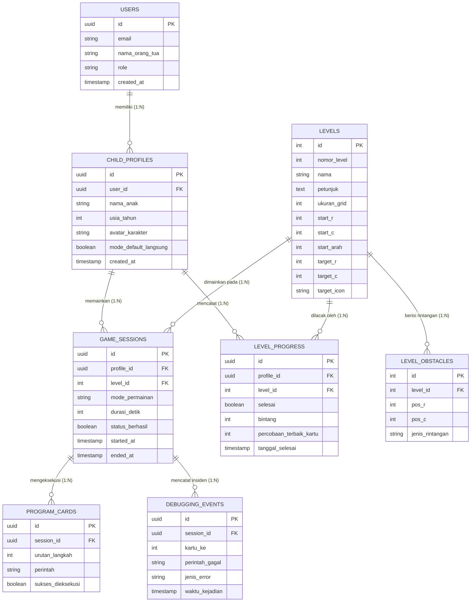

# 🗄️ Entity Relationship Diagram (ERD)
## Robot Mini 3D — Platform Edukasi Coding Anak

Dokumen ini memuat spesifikasi arsitektur data, diagram relasi entitas (**ERD**), kamus data (*data dictionary*), pemetaan *state in-memory* (Streamlit Session State), serta skrip DDL SQL untuk implementasi database relasional (PostgreSQL / SQLite).

---

## 1. Diagram Relasi Entitas (Mermaid ERD)



---

## 2. Kamus Data (Data Dictionary)

### 2.1 Entitas Akun & Profil (`USERS` & `CHILD_PROFILES`)
* **`USERS`**: Menyimpan data orang tua / wali pendamping.
  * `id` (UUID, PK): Pengenal unik akun.
  * `email` (VARCHAR): Email login orang tua.
  * `nama_orang_tua` (VARCHAR): Nama orang tua.
  * `created_at` (TIMESTAMP): Waktu pendaftaran.

* **`CHILD_PROFILES`**: Profil spesifik anak agar perkembangan anak dapat dipantau terpisah.
  * `id` (UUID, PK): Pengenal unik profil anak.
  * `user_id` (UUID, FK): Menunjuk ke akun orang tua (`USERS.id`).
  * `nama_anak` (VARCHAR): Nama panggilan anak.
  * `usia_tahun` (INT): Usia anak (3–6 tahun) untuk menentukan rekomendasi mode awal.
  * `avatar_karakter` (VARCHAR): Ikon robot favorit pilihan anak.
  * `mode_default_langsung` (BOOLEAN): `true` untuk mode langsung (3 th), `false` untuk mode susun kartu (4+ th).

---

### 2.2 Entitas Dunia Game & Level (`LEVELS` & `LEVEL_OBSTACLES`)
* **`LEVELS`**: Definisi tata letak dan konfigurasi papan permainan.
  * `id` (INT, PK): ID numerik level (1–5).
  * `nomor_level` (INT): Urutan kurikulum.
  * `nama` (VARCHAR): Nama level (contoh: *"Maju Terus"*, *"Gawang!"*).
  * `petunjuk` (TEXT): Teks narasi petunjuk untuk anak.
  * `ukuran_grid` (INT): Ukuran matrix papan (4 untuk 4x4, 5 untuk 5x5).
  * `start_r`, `start_c` (INT): Koordinat baris & kolom posisi awal robot.
  * `start_arah` (INT): Arah hadap awal (0: Atas, 1: Kanan, 2: Bawah, 3: Kiri).
  * `target_r`, `target_c` (INT): Koordinat bola atau gawang.
  * `target_icon` (VARCHAR): Ikon target (`⚽` atau `🥅`).

* **`LEVEL_OBSTACLES`**: Lokasi rintangan statis (batu) pada level.
  * `id` (INT, PK): Identifier rintangan.
  * `level_id` (INT, FK): Relasi ke `LEVELS.id`.
  * `pos_r`, `pos_c` (INT): Posisi baris dan kolom rintangan batu `🪨`.
  * `jenis_rintangan` (VARCHAR): Tipe rintangan (default: `'batu'`).

---

### 2.3 Entitas Riwayat Permainan & Algoritma (`GAME_SESSIONS`, `PROGRAM_CARDS`, `DEBUGGING_EVENTS`)
* **`GAME_SESSIONS`**: Rekaman setiap sesi permainan anak.
  * `id` (UUID, PK): Pengenal sesi.
  * `profile_id` (UUID, FK): Profil anak yang bermain.
  * `level_id` (INT, FK): Level yang dimainkan.
  * `mode_permainan` (VARCHAR): `'langsung'` (3 th) atau `'kartu'` (4+ th).
  * `durasi_detik` (INT): Total durasi bermain per sesi (monitoring screen-time 10–15 menit).
  * `status_berhasil` (BOOLEAN): Apakah robot sukses mencapai target.

* **`PROGRAM_CARDS`**: Rangkaian kartu perintah yang disusun oleh anak.
  * `id` (UUID, PK): Pengenal kartu langkah.
  * `session_id` (UUID, FK): Menunjuk ke `GAME_SESSIONS.id`.
  * `urutan_langkah` (INT): Nomor urut kartu (1 hingga maksimal 12).
  * `perintah` (VARCHAR): `'maju'`, `'kiri'`, atau `'kanan'`.
  * `sukses_dieksekusi` (BOOLEAN): Status apakah langkah ini berhasil tanpa tabrakan.

* **`DEBUGGING_EVENTS`**: Log peristiwa saat anak menemui kesalahan (robot menabrak).
  * `id` (UUID, PK): Pengenal insiden.
  * `session_id` (UUID, FK): Sesi permainan terkait.
  * `kartu_ke` (INT): Nomor kartu yang menyebabkan tabrakan.
  * `perintah_gagal` (VARCHAR): Perintah kartu yang salah.
  * `jenis_error` (VARCHAR): `'tabrak_batu'` atau `'tabrak_pinggir'`.

---

### 2.4 Entitas Kemajuan & Skor (`LEVEL_PROGRESS`)
* **`LEVEL_PROGRESS`**: Rekap bintang dan capaian level anak.
  * `id` (UUID, PK): Pengenal catatan progres.
  * `profile_id` (UUID, FK): Menunjuk ke profil anak.
  * `level_id` (INT, FK): Menunjuk ke level.
  * `selesai` (BOOLEAN): Status apakah level sudah berhasil dilewati.
  * `bintang` (INT): Jumlah bintang yang diperoleh (0 atau 1 per level).
  * `percobaan_terbaik_kartu` (INT): Jumlah kartu tersedikit yang berhasil menamatkan level.

---

## 3. Pemetaan ke State Saat Ini (*Streamlit In-Memory Session State*)

Dalam implementasi *runtime* Streamlit saat ini (`app.py`), entitas relasional di atas dipetakan langsung ke struktur memori `st.session_state`:

| Entitas Relasional | Representasi di `st.session_state` | Tipe Data Python |
| :--- | :--- | :--- |
| `CHILD_PROFILES.mode` | `st.session_state.langsung` | `bool` |
| `LEVELS` | Modul konstanta global `LEVELS` | `list[dict]` |
| `LEVEL_PROGRESS.bintang` | `st.session_state.bintang` | `int` |
| `LEVEL_PROGRESS.selesai` | `st.session_state.berhasil` | `list[bool]` |
| `PROGRAM_CARDS` | `st.session_state.program` | `list[str]` (contoh: `['maju', 'kanan']`) |
| Koordinat Robot Saat Ini | `st.session_state.pos`, `st.session_state.arah` | `tuple(r, c)`, `int (0..3)` |
| Efek Suara Runtime | `st.session_state.suara` | `str` (`'maju'`, `'tabrak'`, `'menang'`) |

---

## 4. Skrip DDL Database (PostgreSQL / SQLite Compatible)

```sql
-- 1. Tabel Akun Orang Tua
CREATE TABLE users (
    id UUID PRIMARY KEY DEFAULT gen_random_uuid(),
    email VARCHAR(255) UNIQUE NOT NULL,
    nama_orang_tua VARCHAR(100) NOT NULL,
    created_at TIMESTAMP WITH TIME ZONE DEFAULT CURRENT_TIMESTAMP
);

-- 2. Tabel Profil Anak
CREATE TABLE child_profiles (
    id UUID PRIMARY KEY DEFAULT gen_random_uuid(),
    user_id UUID NOT NULL REFERENCES users(id) ON DELETE CASCADE,
    nama_anak VARCHAR(50) NOT NULL,
    usia_tahun INT CHECK (usia_tahun BETWEEN 2 AND 10),
    avatar_karakter VARCHAR(20) DEFAULT '🤖',
    mode_default_langsung BOOLEAN DEFAULT TRUE,
    created_at TIMESTAMP WITH TIME ZONE DEFAULT CURRENT_TIMESTAMP
);

-- 3. Tabel Master Level
CREATE TABLE levels (
    id INT PRIMARY KEY,
    nomor_level INT NOT NULL UNIQUE,
    nama VARCHAR(100) NOT NULL,
    petunjuk TEXT NOT NULL,
    ukuran_grid INT NOT NULL DEFAULT 4,
    start_r INT NOT NULL,
    start_c INT NOT NULL,
    start_arah INT NOT NULL DEFAULT 0,
    target_r INT NOT NULL,
    target_c INT NOT NULL,
    target_icon VARCHAR(10) DEFAULT '⚽'
);

-- 4. Tabel Rintangan Level
CREATE TABLE level_obstacles (
    id SERIAL PRIMARY KEY,
    level_id INT NOT NULL REFERENCES levels(id) ON DELETE CASCADE,
    pos_r INT NOT NULL,
    pos_c INT NOT NULL,
    jenis_rintangan VARCHAR(30) DEFAULT 'batu',
    UNIQUE (level_id, pos_r, pos_c)
);

-- 5. Tabel Progres & Bintang Level Anak
CREATE TABLE level_progress (
    id UUID PRIMARY KEY DEFAULT gen_random_uuid(),
    profile_id UUID NOT NULL REFERENCES child_profiles(id) ON DELETE CASCADE,
    level_id INT NOT NULL REFERENCES levels(id) ON DELETE CASCADE,
    selesai BOOLEAN DEFAULT FALSE,
    bintang INT DEFAULT 0,
    percobaan_terbaik_kartu INT,
    tanggal_selesai TIMESTAMP WITH TIME ZONE,
    UNIQUE (profile_id, level_id)
);

-- 6. Tabel Sesi Permainan
CREATE TABLE game_sessions (
    id UUID PRIMARY KEY DEFAULT gen_random_uuid(),
    profile_id UUID NOT NULL REFERENCES child_profiles(id) ON DELETE CASCADE,
    level_id INT NOT NULL REFERENCES levels(id) ON DELETE CASCADE,
    mode_permainan VARCHAR(20) NOT NULL CHECK (mode_permainan IN ('langsung', 'kartu')),
    durasi_detik INT DEFAULT 0,
    status_berhasil BOOLEAN DEFAULT FALSE,
    started_at TIMESTAMP WITH TIME ZONE DEFAULT CURRENT_TIMESTAMP,
    ended_at TIMESTAMP WITH TIME ZONE
);

-- 7. Tabel Susunan Kartu Program
CREATE TABLE program_cards (
    id UUID PRIMARY KEY DEFAULT gen_random_uuid(),
    session_id UUID NOT NULL REFERENCES game_sessions(id) ON DELETE CASCADE,
    urutan_langkah INT NOT NULL,
    perintah VARCHAR(20) NOT NULL CHECK (perintah IN ('maju', 'kiri', 'kanan')),
    sukses_dieksekusi BOOLEAN DEFAULT TRUE
);

-- 8. Tabel Log Peristiwa Debugging
CREATE TABLE debugging_events (
    id UUID PRIMARY KEY DEFAULT gen_random_uuid(),
    session_id UUID NOT NULL REFERENCES game_sessions(id) ON DELETE CASCADE,
    kartu_ke INT NOT NULL,
    perintah_gagal VARCHAR(20) NOT NULL,
    jenis_error VARCHAR(50) NOT NULL,
    waktu_kejadian TIMESTAMP WITH TIME ZONE DEFAULT CURRENT_TIMESTAMP
);
```
